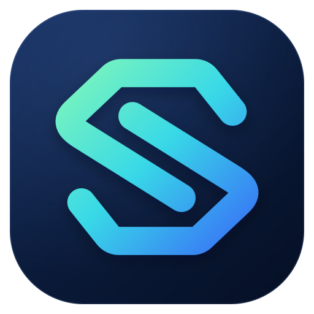
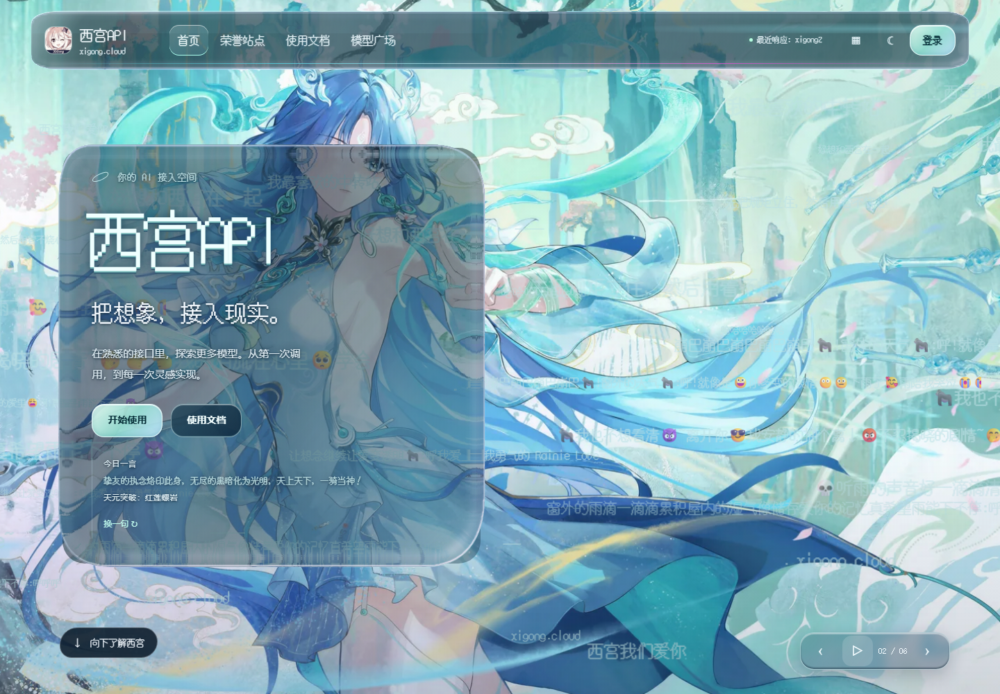
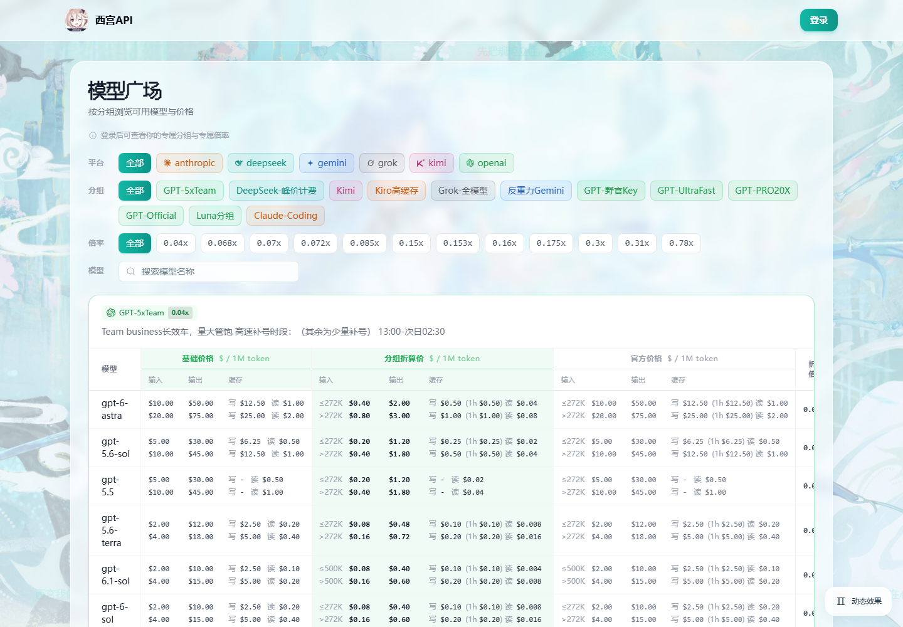
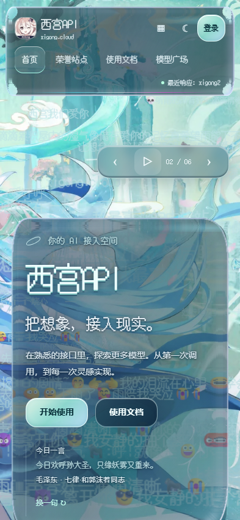

<div align="center">



# 西宫 · Sub2API 魔改版

**把想象，接入现实。**

在 Sub2API 的多模型 API 网关之上，加入沉浸式首页、液态玻璃控制台、渠道状态、模型广场与集群增强。

[](LICENSE)
[](backend/go.mod)
[](frontend/package.json)
[](https://xigong.cloud)

[在线演示](https://xigong.cloud) · [快速部署](docs/DEPLOYMENT.md) · [功能与差异](docs/FEATURES.md) · [截图画廊](docs/SCREENSHOTS.md) · [English](README_EN.md)

</div>



> **独立社区定制版，不是上游官方发行版。** 基于 [Wei-Shaw/sub2api](https://github.com/Wei-Shaw/sub2api)，保留上游版权与 LGPL-3.0 许可；感谢上游作者和全部贡献者。演示站是正在运行的业务站点，不提供公开管理员账号，请勿压测、扫描或提交真实敏感信息。

## 当前源码：0.2.18-custom-cluster-v3 · 2026-10-26

本次同步上游 v0.2.18 与最新西宫定制源码，新增收益系统、SubNexus 只读机器人接口、可选主被动监控、倍率历史、独立速率观测，并包含 Grok 下载、集群容量和结算恢复修复。

**[21 项功能逐项说明](docs/CUSTOM_FEATURES.md) · [本次变更与迁移](CHANGELOG.md) · [机器人 API](docs/SUBNEXUS_API.md)**

仅发布源码，不执行生产部署；既有截图保留原拍摄时间，不冒充本次新功能截图。

## 有什么不同

| 方向 | 定制能力 |
| --- | --- |
| 沉浸式体验 | 自托管壁纸与字体、液态玻璃折射、粒子标题、轮播、主题与动态效果开关、移动端适配 |
| 站点内容 | 可管理首页外观、文档、公告、荣誉站点、分设备图片与焦点、外部一言 |
| 渠道可观测性 | 真实请求与主动探测结合、历史状态、首字与输出速率、公开首页状态卡、公开分组自动配给 |
| 模型与价格 | 模型广场、分组模型白名单、自定义价卡、长上下文阈值、Fast/Flex/Ultrafast 档位策略与标识 |
| 用户工作流 | 分组分类、API 密钥夹、Key 级提示词模板、用量费用与缓存统计 |
| 收益与集成 | 分组成本版本、收益管理/公示、个人累计收益、独立授权的八类机器人只读查询 |
| 多节点 | 入口/控制器/工作节点/迁移器角色、mTLS、准入控制、幂等结算与本地恢复槽、集群控制台 |

保留上游的账号池、OAuth/API Key、兼容协议转发、计费、支付、权限和后台管理能力。完整说明与限制见 [功能说明](docs/FEATURES.md)。提示词模板不保证模型行为，也不绕过服务商条款。

## 快速开始

推荐先用 **Docker Compose 从本仓库源码构建单节点版本**。现有上游镜像不包含这些定制功能，不要把 `weishaw/sub2api:latest` 当作本版镜像。

```bash
git clone https://github.com/hongkong7530/sub2api-xigong.git
cd sub2api-xigong
cp deploy/.env.example deploy/.env
# 编辑 deploy/.env，设置独立强密码、固定 JWT_SECRET 和 TOTP_ENCRYPTION_KEY。
# 新部署建议 BIND_HOST=127.0.0.1，再通过 HTTPS 反向代理对外服务。
docker compose --env-file deploy/.env -f deploy/docker-compose.xigong.yml up -d --build
```

首次初始化后访问 `http://127.0.0.1:8080`；如在远程服务器部署，可通过 SSH 隧道访问。管理员信息来自自己的环境配置，未指定时请安全查看首次初始化日志，切勿公开日志中的密码。

**继续阅读：[部署与升级](docs/DEPLOYMENT.md) · [本地开发](docs/DEVELOPMENT.md) · [架构与集群](docs/ARCHITECTURE.md)。**

## 页面预览

<table>
<tr><td width="70%"></td><td width="30%"></td></tr>
</table>

全部图片均为实际页面截图，不是设计效果图；未登录页面可能随站点配置显示空状态、登录要求或实时故障，不伪造监控健康。拍摄范围见 [截图说明](docs/SCREENSHOTS.md)。

## 文档导航

- [功能与上游差异](docs/FEATURES.md)
- [部署、初始化、反向代理、备份与升级](docs/DEPLOYMENT.md)
- [开发、构建与测试](docs/DEVELOPMENT.md)
- [架构与集群边界](docs/ARCHITECTURE.md)
- [真实截图与拍摄方法](docs/SCREENSHOTS.md)
- [变更记录](CHANGELOG.md) / [来源与许可](NOTICE.md) / [第三方素材](docs/ASSETS.md)
- [贡献指南](CONTRIBUTING.md) / [安全报告](SECURITY.md) / [已知限制](docs/KNOWN_LIMITATIONS.md)
- 专题：[支付](docs/PAYMENT_CN.md) · [组合分组](docs/COMPOSITE_GROUPS.md) · [插件开发](docs/PLUGIN_DEVELOPMENT.md) · [异步图片任务](docs/ASYNC_IMAGE_TASKS.md)

## 发布与安全边界

这是从当前正式定制源码导出的**独立公开快照**，不是原生产目录或私人 Git 历史的镜像。保留构建所需源码、生成代码、锁文件、迁移和许可；排除真实配置、数据库、缓存、日志、证书私钥、生产部署记录和内部账务材料。

公开源码与在线演示站配置、素材及部署进度可能不同。本次开源不代表对演示站进行了重新部署，也不承诺所有上游、第三方素材和付费模型始终可用。当前验证范围与既有测试限制见 [已知限制](docs/KNOWN_LIMITATIONS.md)。

## 许可与致谢

代码沿用 [GNU LGPL v3](LICENSE)，配套 GPL v3 全文见 [COPYING](COPYING)。依赖与字体遵循各自许可；第三方壁纸并不因放入仓库而自动成为 LGPL 作品，详见 [素材说明](docs/ASSETS.md)。

使用者须遵守上游模型服务条款、适用法律及隐私义务；开放源码不授予第三方账号、模型、商标或内容的使用权。本项目无可用性、收益或性能保证。
