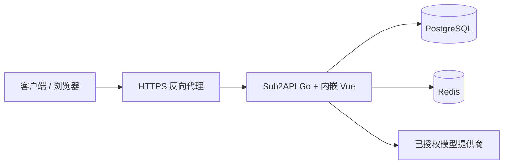
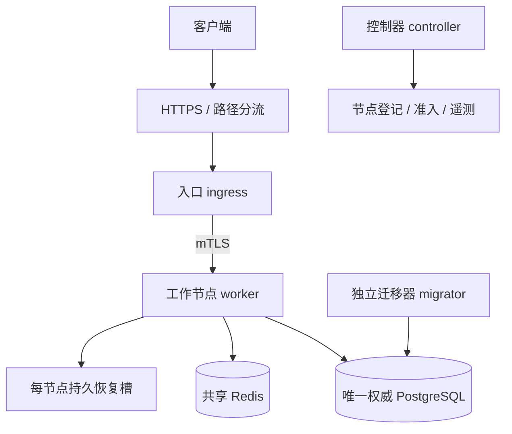

# 架构与集群边界

## 单节点

Go 服务承接权限、调度、网关、计费、支付与内容管理；Vue 负责控制台与公开页面。PostgreSQL 是持久业务与账务来源，Redis 用于缓存、协调与相关运行状态。不要把清 Redis 当作修复账务的方法。

## 可选角色化集群

- **入口**：面板与公开 HTTP 入口、鉴权和工作调度；纯 worker 不应额外开放管理面板。
- **工作节点**：处理网关工作并产生费用/完成事实，依赖证据进行结算，不因暂时错误抹去恢复状态。
- **控制器**：管理节点登记、目标状态与实际准入，遥测陈旧要显示未知，不拿旧样本冒充实时健康。
- **迁移器**：单独执行 schema/设置迁移，使用明确的数据库属主与权限，不作为常驻服务器。

角色允许组合，但每个部署必须按当前配置校验实际角色，不能照搬演示站机器名称和地址。

## 结算与恢复

费用事件、工作完成事实和账务提交是不同阶段。重复投递依靠幂等标识，而不是重放上游模型调用。数据库不可用时，已知事实进入本地受保护恢复槽；只有权威持久化确认后才能释放。未知结果需保留核对，禁止直接清槽、删执行状态或清 Redis generation 以制造绿色面板。

本地恢复目录是数据，不是缓存；必须具备持久磁盘、正确权限、备份与足够空间。账务事件数量或 health 200 不能独自证明完整一致性。

## 容量与网络

- 所有应用连接池总和加管理/迁移余量不能超过 PostgreSQL 连接预算。
- 跨区域数据库往返会影响面板与结算，增加工作节点不保证增加吞吐。
- 只有受控代理的转发头可被信任；公开站点和工作节点端口分离。
- 反向代理应分别验证普通页面、SSE、WebSocket 与工作节点 mTLS；纯网关监听器不一定服务 SPA。

## 发布

公开源码发布与生产发布分开。本次开源不调整演示站角色、权重、数据库、配置或进程。应用滚动替换应逐节点验证恢复准入与回滚点；正常 SIGTERM 并不等于承诺所有既有长流永不中断。数据库迁移回滚必须独立评估。

## 实现入口

- `backend/internal/cluster/`：集群运行时、准入、传输、恢复与结算。
- `backend/internal/config/`：角色及启动配置。
- `backend/migrations/`：历史与新增迁移。
- `tools/cluster/`：管理脚本，具有真实写入能力，须在隔离环境阅读和验证后使用。
- `frontend/src/`：集群控制台、公开内容和业务界面。
