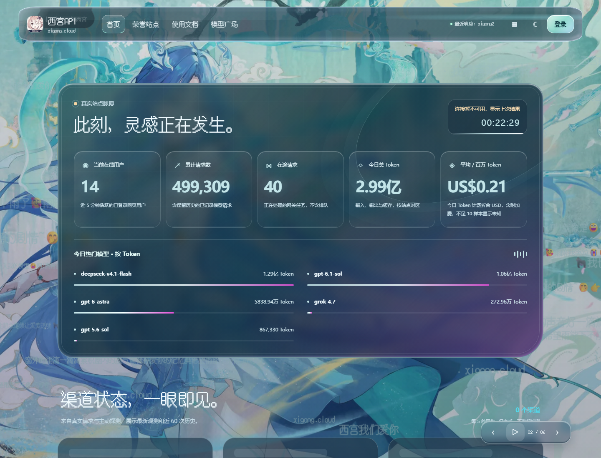
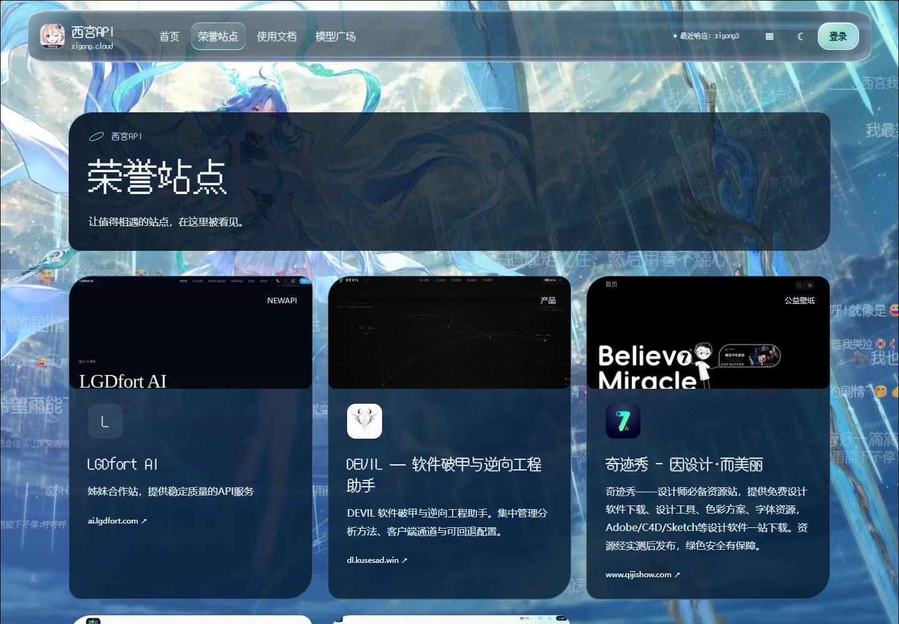

# 真实截图画廊

来源：<https://xigong.cloud>，匿名公开页面。截图不使用接口 mock，不构造管理员身份，不注入虚假业务数据，也不将空状态或失败状态修成绿色。拍摄时间、最终 URL、视口与图片哈希见同目录的 `screenshots/capture-manifest.json`。

## 桌面首页

1440 × 1000 视口；保留实际品牌、玻璃表面、壁纸和导航。


## 手机首页

393 × 852 视口，展示真实移动端布局。


## 首页统计与渠道状态

页面真实公开状态，可能随站点配置和采样时间变化；健康接口可达不等于全部渠道正常。



## 模型广场

模型与价格由演示站当时配置决定，不是永远有效的报价或可用性承诺。


## 荣誉站点

展示实际公开列表；外站图片来自其提供者，自动截图服务不保证永远可达。



## 复现

仅在有权访问且允许拍摄的站点使用。工具不会登录、付费调用、执行探测或写入配置：

```bash
python -m pip install playwright
python -m playwright install chromium
python scripts/capture_screenshots.py --base-url https://xigong.cloud --output docs/screenshots
```

只截图匿名公开页，不提供管理员页面截图，避免公开账号、用户账务或私有运行信息。拍摄过程等待字体与图片加载并通过页面已有控制暂停轮播；不改变生产设置。真实页面的视觉与数据会随站点变化，截图不能证明当前源码的全部后端合同或生产发布状态。
